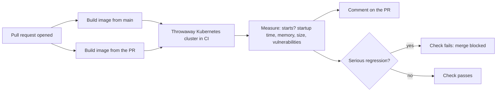

# Shakedown

**Test-deploy every pull request before it's merged.**

Shakedown is a GitHub Action that builds the pull request *and* the main branch, runs both in a throwaway Kubernetes cluster inside CI, and tells the reviewer what the change actually does once it's packaged and running: does it still start, how fast, how much memory, how big the image is, and which vulnerabilities it adds. Serious regressions block the merge, with a maintainer override.

> 🚧 **Work in progress.** Portfolio and learning project. See [Status](#status) for what works today.

---

## Why

A pull request can look harmless in code review and still break or bloat the app once it's deployed.

A real example, measured on this repo's sample app: changing **five characters** in a Dockerfile (`python:3.13-slim` → `python:3.13`) makes the image **9× bigger**, with no change to the app's code:

| Base image | Size on disk | Compressed |
|---|---|---|
| `python:3.13-slim` | 176 MB | 43.1 MB |
| `python:3.13` | **1.61 GB** | **414 MB** |

The extra ~1.4 GB is compilers, development libraries and version-control tools the app never uses. It means slower deployments and more packages that can carry vulnerabilities. The diff a reviewer sees is just `-slim` deleted.

Shakedown turns that invisible change into one visible line on the pull request.

## How it works



- **Both versions are built straight from git history** (`git archive` piped into `docker build`), so nothing has to be checked out or switched.
- **Main and the PR are measured in the same run, on the same machine**, several times each, because shared CI runners are noisy.
- **Hard blocks:** the app won't start, or a new critical vulnerability. **Warnings only:** size, memory or startup time past a threshold.
- **A human always decides.** Shakedown never merges or deploys anything. It reports and fails a check; a maintainer can override it with a label.

## Status

| | Feature |
|---|---|
| ✅ | Sample app to test against (`examples/hello-app`) |
| ✅ | Installable command-line tool (`shakedown`) |
| ✅ | Read an image's size from Docker (`shakedown size`) |
| 🔨 | Build main and the PR from git and compare them (`shakedown compare`) |
| ⏳ | Report + merge gate (exit code), Markdown comment on the PR |
| ⏳ | GitHub Action wrapper, running on every pull request |
| ⏳ | Test-deploy both versions in a temporary Kubernetes cluster (kind) |
| ⏳ | Linux image checks: added packages, running as root, setuid files, resource usage |
| ⏳ | Vulnerability comparison (Trivy) |
| ⏳ | Results on real pull requests from open-source projects |

## Try it locally

Requires Python 3.11+, Docker and git, on Linux.

```bash
git clone https://github.com/aziz-hizem/shakedown.git
cd shakedown
python3 -m venv .venv
source .venv/bin/activate
pip install -e .

docker build -t hello-app:slim examples/hello-app
shakedown size hello-app:slim
```

## Built with

Python · Docker · GitHub Actions · Kubernetes (kind) · Trivy · Linux

## Design notes

- **Python CLI at the core, thin GitHub Action around it.** The same tool runs on a laptop and in CI.
- **Exit codes are the gate:** `0` pass, `1` regression found, `2` misconfigured (never a silent green).
- **stdout carries only the report; logs and errors go to stderr**, so the PR comment stays clean.
- **External commands are called without a shell**, so untrusted input (branch or image names) can't inject commands.